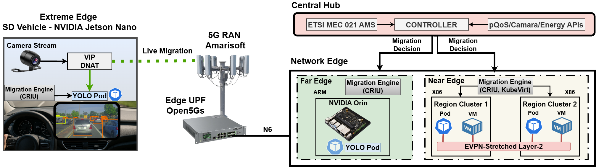

# DRIFT

**Dynamic Relocation of Intelligent Functions at the extreme Edge**

DRIFT moves running services, with their state and sessions, across the edge continuum over 5G:
between independent edge clusters, and between the edge and a vehicle. It decides where each
service should run from the green energy of each site and the network quality reported by
predictive QoS (pQoS) and CAMARA Quality on Demand (QoD), and exposes every move as a standard
ETSI MEC 021 mobility procedure.

**Demo video** (click to watch):

[](https://youtu.be/TtmajA0sB-E)

Measurements and the scripts behind them: [DRIFT dataset](https://github.com/teo-tsou/DRIFT-dataset).

---

## What it does

| Capability | How |
|---|---|
| Container live migration between edge clusters | CRIU post-copy; the pod keeps its IP over an EVPN-stretched Layer 2, TCP sessions survive |
| VM live migration between edge clusters | KubeVirt decentralized live migration (memory and disk) |
| Live migration between the vehicle and the edge over 5G | CRIU stop-and-copy with a delta against the previous checkpoint; about 1 s freeze, about 0.4 MiB over 5G |
| Stream follows the service | a virtual IP on the vehicle redirects the camera stream to wherever the service runs |
| Energy- and QoS-aware placement | greenness of each site, pQoS predictions, QoD sessions, CPU and memory |
| Standard northbound interface | ETSI GS MEC 021 Application Mobility Service, triggered by an application, a pQoS notification or the placement engine |
| Rollback | a failed restore on the target returns the service to its source |
| Zero-touch onboarding | Ansible roles install K3s, CRI-O, CRIU, KubeVirt, networking and the migration components on a new site |

## Architecture



- **Central hub:** the MEC 021 API, the DRIFT controller (placement), the backend (migration
  engine, cluster management) and the web UI, all as Docker containers.
- **Near edge:** x86 K3s clusters joined by an EVPN/VXLAN stretched Layer 2; pods (CRIU) and VMs (KubeVirt).
- **Far edge:** ARM64 K3s cluster (NVIDIA Jetson AGX Orin).
- **Extreme edge:** the vehicle, an ARM64 K3s cluster (NVIDIA Jetson Orin Nano) reachable only over 5G.

---

## Repository layout

```
backend/                 FastAPI backend: cluster management, migration engine, scenario engine
frontend/                Web UI (dashboard, cluster views, extreme-edge view)
mec/mec021-api/          ETSI MEC 021 Application Mobility Service
mec/drift-controller/    Placement: greenness, pQoS, QoD, resources
mec/camara-mocks/        Local stand-ins for the CAMARA/pQoS/energy APIs (for running without a testbed)
mec/tools/               Trace replay and rollback test tools
ansible/                 Playbooks and roles to onboard edge sites
scripts/                 Node preflight, vehicle and edge helpers (5G routing, tunnels, probes)
demo/                    Demo workloads: video server, YOLO perception, dashcam sender, day scenario
central_hub/deploy/      Backup and restore of the hub database
docs/                    Node requirements, pQoS trigger design, images
docker-compose.yml       The whole central hub stack
install.sh               One-command hub installer
```

---

## Quick start: central hub

### Requirements

| Requirement | Minimum |
|---|---|
| OS | Ubuntu 22.04 / Debian 12 / Rocky Linux 9 |
| CPU / RAM / Disk | 4 cores / 8 GB / 40 GB |
| Docker | installed by `install.sh` if missing |
| Network | SSH access to the edge nodes; internet during install |

### Install

```bash
git clone https://github.com/teo-tsou/DRIFT.git
cd DRIFT
sudo bash install.sh
```

The installer installs Docker if needed, creates an SSH key for reaching the edge nodes, writes a
default `.env`, and builds and starts the stack.

### Configure

Settings are read from `.env` (never committed). The main ones:

| Variable | Purpose |
|---|---|
| `DATABASE_URL` | PostgreSQL of the hub (written by the installer) |
| `ECB_API_URL`, `ECB_API_USER`, `ECB_API_PASSWORD` | Energy/greenness API; without it the local energy mock is used |
| `UE_IMSI`, `DRIFT_XE_IMSI` | The 5G UE served by the application and the vehicle UE |
| pQoS / QoD endpoints | See `docker-compose.yml`; the `camara-*` mocks are used when no testbed API is set |

### Services

| Service | Port | URL |
|---|---|---|
| Web UI | 3000 | `http://<hub-ip>:3000` |
| Backend API (Swagger) | 8000 | `http://<hub-ip>:8000/docs` |
| ETSI MEC 021 API | 8010 | `http://<hub-ip>:8010/docs` |
| DRIFT controller | 8011 | `http://<hub-ip>:8011/docs` |
| CAMARA QoD / pQoS / Location mocks | 9001 to 9003 | local testing only |
| Energy telemetry mock | 9004 | local testing only |
| pgAdmin | 5050 | database admin |

```bash
docker compose ps                  # status
docker compose logs -f backend     # backend and Ansible output
docker compose up -d               # start again after a reboot
docker compose down                # stop
```

---

## Onboarding an edge site

1. **Check the node.** Kernel checkpoint/restore support, CRIU, `/dev/kvm` and the other gates:

   ```bash
   sudo ./scripts/drift-preflight.sh check <peer_ip>
   ```

   Details, including the Jetson kernel options, are in [docs/node-requirements.md](docs/node-requirements.md)
   (`scripts/drift-jetson-kernel.sh` rebuilds the Jetson kernel with them).

2. **Add the site** from the web UI (Deploy Edge Cluster), or set it in
   `ansible/inventories/production/hosts.yml`. The backend runs the playbooks below in order:

   | Playbook | Installs |
   |---|---|
   | `prepare_all_nodes.yml` | base packages, kernel settings |
   | `provision_k3s_server.yml`, `join_k3s_workers.yml` | K3s |
   | `setup_crio.yml`, `setup_criu.yml` | CRI-O and CRIU (container checkpoint/restore) |
   | `deploy_kube_ovn.yml`, `deploy_multus.yml`, `setup_networking.yml` | cluster networking |
   | `deploy_kubevirt.yml`, `deploy_longhorn.yml` | VMs and RWX storage (x86 sites) |
   | `setup_evpn_l2.yml` | EVPN/VXLAN stretched Layer 2 between sites |
   | `setup_pod_migration.yml`, `prepare_xcluster_migration.yml` | DRIFT migration engine and node agent |
   | `deploy_monitoring.yml` | Prometheus and Grafana |

3. **Vehicle (extreme edge).** The vehicle is reached only over 5G: `scripts/vehicle/` holds the
   5G modem service, the routing that keeps DRIFT traffic on the 5G interface, the management
   tunnel to the hub and the latency probe. See [scripts/vehicle/README.md](scripts/vehicle/README.md).

---

## Using DRIFT through ETSI MEC 021

Register the application with the UE it serves (this also subscribes DRIFT to the pQoS
notifications of that UE):

```bash
curl -X POST http://<hub-ip>:8010/amsi/v1/app_mobility_services \
  -H 'Content-Type: application/json' -d '{
    "registered_app_context": {
      "associated_app_id": "yolo",
      "source_cluster": "<cluster-id>",
      "source_namespace": "default",
      "vm_name": "yolo-pod",
      "resource_kind": "pod",
      "ue_imsi": "<imsi>",
      "min_dl_mbps": 4
    },
    "service_continuity_mode": 1
  }'
```

Start a relocation. Leave `target_cluster` out and DRIFT picks the best site itself:

```bash
curl -X POST http://<hub-ip>:8010/amsi/v1/app_mobility_services/<ams-id>/mobility_procedures \
  -H 'Content-Type: application/json' -d '{}'
```

Follow it until it is `COMPLETED` (or `FAILED`, after the service has been rolled back to its source):

```bash
curl http://<hub-ip>:8010/amsi/v1/app_mobility_services/<ams-id>/mobility_procedures/<procedure-id>
```

With `"autonomous_trigger": true` (the default), a pQoS degradation for the UE starts the
procedure on its own. Subscriptions for procedure events are under `/amsi/v1/subscriptions`.

---

## Running the demo

The workloads of the demo video are in `demo/`:

| Workload | Where | Files |
|---|---|---|
| Video server with a long-lived session, and its stall probe | edge to edge | `demo/video-server/` |
| YOLOv8n perception pod that draws the server clock in every frame | edge to edge | `demo/yolo/` |
| Alpine VM streaming the same video | edge to edge | `demo/video-server/vm-video.yaml` |
| Dashcam sender (12 FPS UDP) and YOLO26n receiver | vehicle and edge | `demo/emt-yolo/` |
| A day of green-aware placement | vehicle and edge | `demo/emt-yolo/day_scenario.py` |

1. Deploy the receiver on the vehicle and the sender on the vehicle's camera side:

   ```bash
   kubectl apply -f demo/emt-yolo/emt-yolo-vehicle.yaml
   kubectl apply -f demo/emt-yolo/emt-sender-vehicle.yaml
   ```

2. Register it with MEC 021 (above) and move it from the web UI or the API. The extreme-edge view
   of the UI shows where the service runs, the camera FPS and every migration.

3. Turn on the scenario engine (Extreme Edge view → Autopilot) to let DRIFT follow the greenness
   and the network on its own, or replay a whole day:

   ```bash
   python3 demo/emt-yolo/day_scenario.py
   ```

See [demo/emt-yolo/README.md](demo/emt-yolo/README.md) and
[demo/video-server/README.md](demo/video-server/README.md) for the details of each workload.

---

## Acknowledgment

DRIFT was carried out within the ENVELOPE project, funded by the European Union under the SNS
Joint Undertaking (Horizon Europe, grant agreement No 101139048).

## Copyright & IP

© 2026 Theodoros Tsourdinis, Sorbonne Université. All rights reserved.

This software is a result of the DRIFT project. It builds upon proprietary background IP owned by
the author and licensed to the DRIFT consortium for use within the scope of the project.
Redistribution or use outside the agreed project terms requires the author's prior written
permission. See [LICENSE](LICENSE) for full terms.
